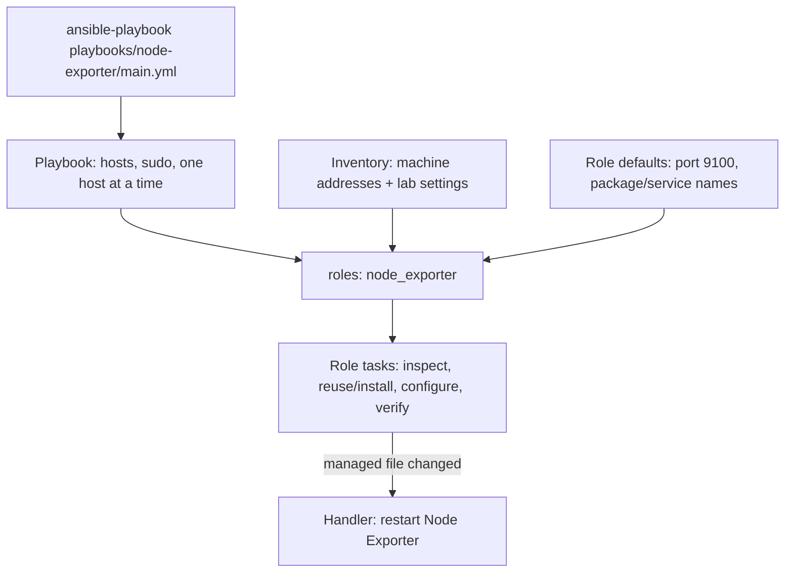

# Learn roles through our Node Exporter job

**You still run a playbook.** A role gives its reusable tasks and supporting files
a standard home. Our Node Exporter job now uses this structure; other jobs keep
their current layout. Preparing this example has not run anything on a host.



## 1. Where each part lives

```text
ansible/
├── ansible.cfg                         # Where Ansible finds inventory and roles
├── requirements.yml                    # Downloaded collection dependencies
├── inventory/
│   ├── hosts.yml                        # Machines and groups
│   ├── group_vars/all/node-exporter.yml # Our lab's role inputs
│   └── host_vars/                       # Settings for one machine
├── playbooks/node-exporter/
│   ├── main.yml                         # Choose targets; call the role
│   └── README.md                        # Manual preview/run guide
├── roles/node_exporter/                 # Our reusable implementation
│   ├── defaults/main.yml                # Fallback inputs
│   ├── tasks/main.yml                   # Role entry point
│   ├── tasks/install.yml                # Included when installation is needed
│   ├── tasks/verify.yml                 # Included for actual-run verification
│   ├── handlers/main.yml                # Restart after a managed config change
│   ├── templates/listen.conf.j2         # Listener file with placeholders
│   └── README.md                        # Role inputs and behavior
└── vendor_roles/                        # Downloaded roles; ignored by Git
```

`vendor_roles/` appears when you download a role into it. Our own roles are
committed under `roles/`; their code arrives with the Git checkout.

In [ansible.cfg](ansible.cfg):

```ini
[defaults]
roles_path = ./roles:./vendor_roles
```

This lets our nested playbooks find the shared roles. Run commands from `ansible/`
so this configuration and the existing inventory are selected.

## 2. The playbook remains the entry point

[playbooks/node-exporter/main.yml](playbooks/node-exporter/main.yml):

```yaml
- name: Ensure Linux VMs and Proxmox hosts expose systemd host metrics
  hosts: linux_vms:proxmox_hosts
  gather_facts: false
  become: true
  serial: 1
  any_errors_fatal: true
  roles:
    - node_exporter
```

| Part | Meaning |
| --- | --- |
| `hosts` | Choose Linux VMs, including K3s nodes, and Proxmox hosts |
| `become` | Use the existing sudo setup |
| `serial: 1` | Finish one machine before starting another |
| `roles` | Load and run `roles/node_exporter/tasks/main.yml` |

The role does not pick an inventory or grant itself SSH/sudo access. It can
still check a machine and refuse unsuitable targets. This role rejects a container
exporter instead of treating it as the systemd service we want.

## 3. Follow the work inside the role

1. Ansible loads the role's defaults and handlers.
2. `tasks/main.yml` explicitly gathers minimal facts and checks systemd service state.
3. It chooses whether to reuse an exporter, start an existing service or manage a new install.
4. When needed, `include_tasks: install.yml` loads the installation tasks.
5. `template: src=listen.conf.j2` finds the file in this role's `templates/` folder.
6. A changed managed listener file notifies `Restart managed node exporter` in `handlers/main.yml`.
7. This role explicitly flushes queued handlers before checking the endpoint.
8. `include_tasks: verify.yml` performs verification during an actual run.

**Ansible does not run every YAML file in `tasks/`.** It starts with `main.yml`;
that file includes the other task files. Handlers are loaded, but run only when notified.
Templates are source files until a task renders and copies them onto a machine.

## 4. Defaults versus our lab settings

[Role defaults](roles/node_exporter/defaults/main.yml):

```yaml
node_exporter_listen_address: ''  # Required input; caller chooses an address
node_exporter_port: 9100
node_exporter_verify_from: ''     # No extra monitoring-machine probe by default
```

[Our inventory settings](inventory/group_vars/all/node-exporter.yml):

```yaml
node_exporter_listen_address: "{{ network_address | default(ansible_host | default('')) }}"
node_exporter_verify_from: tantrum
```

The same role therefore works with each machine's own address. The reusable
code does not need to know the name Tantrum. Inventory overrides role defaults;
a host-specific inventory value can specialize a group setting. `-e` can override
these inputs for a deliberate run. Secrets remain in the existing encrypted vars.

| Role folder | Purpose | Loaded/run how? |
| --- | --- | --- |
| `defaults/main.yml` | Inputs users should be able to override | Automatically loaded; low priority |
| `tasks/main.yml` | Work to perform | Automatically used as role entry point |
| `handlers/main.yml` | Actions triggered by changes | Loaded automatically; execution needs a notification |
| `templates/` | Files with Jinja placeholders | Used by `template` tasks |
| `files/`, optional | Files copied without templating | Used by `copy` tasks |
| `vars/main.yml`, optional | Higher-priority role variables | Automatically loaded; inventory usually cannot override these |
| `meta/main.yml`, optional | Role metadata/dependencies | Needed when describing/publishing dependencies and role support |

Only create folders you need. Keep configurable inputs in `defaults/`, rather
than `vars/`, so an inventory setting can replace them. Roles do not isolate
all variables like private variables in a programming language; use descriptive
prefixes such as `node_exporter_` to avoid collisions.

## 5. Reuse it from another playbook

For example, a future job for newly created non-K3s VMs could call the same role:

```yaml
- name: Add host metrics to ordinary VMs
  hosts: other_vms
  become: true
  roles:
    - node_exporter
```

This is a teaching example, not a second deployed job. It uses the same tasks,
template, defaults and handler. Fixing the shared role fixes both callers.
Each caller can still choose different hosts and inputs.

## 6. Roles, modules, collections and Galaxy

| Term | What it contains | Example |
| --- | --- | --- |
| Module | One kind of action used by a task | `ansible.builtin.apt` installs a package |
| Role | Related tasks + inputs + supporting files | Our `node_exporter` |
| Collection | A versioned bundle of roles, modules and/or plugins | `ansible.posix` |
| Ansible Galaxy | A place to find/share roles and collections | Download with `ansible-galaxy` |

You already use community code: [requirements.yml](requirements.yml) declares
the `ansible.posix` collection, used by the SSH-key job's `authorized_key` module.
Your existing dependency command is:

```bash
ansible-galaxy collection install -r requirements.yml
```

To download a standalone community role, an illustrative example is:

```bash
ansible-galaxy role install geerlingguy.apache --roles-path ./vendor_roles
```

This downloads role code onto the controller. Apache installation happens only
if you write and run a playbook calling that role. It is not a dependency of our
Node Exporter job. For real dependencies, record a reviewed version/tag/commit
in a requirements file; do not edit downloaded code as if it were our own role.
Our current collection constraint allows 2.x releases; an exact version gives
more repeatable installs when we choose to lock dependencies.

Our role needs no Galaxy installation: it is already under `roles/`. Later it
could be shared as a standalone Git/Galaxy role, with documented inputs, supported
systems, a license and versioned releases. Several related roles could instead
form a collection, for example `homelab.observability.node_exporter`. That is a
possible future package name, not something published by this project today.

## 7. How we can extend this project

| Job | Sensible next step |
| --- | --- |
| Node Exporter | Shared role implemented here; learn it first |
| Baseline packages / guest agent | Good next conversion from a familiar playbook |
| Fluent Bit | Later: role for reusable agent work, playbook for targets/profile choices |
| SSH keys / certificates | Convert when another setup playbook needs the same work |
| Network recovery / one-time migrations | Keep their explicit recovery/state decisions visible in the entry playbook |

A larger project could keep the current `playbooks/JOB/main.yml` entry points
while adding `roles/guest_baseline`, `roles/fluent_bit`, and `roles/ssh_access`.
You do not need a catch-all playbook that runs everything.

When converting Fluent Bit, preserve task order, state checks, handlers and
verification. Its `settings.yml` currently loads as **playbook variables**;
moving it into role defaults would change which overrides win. File lookups
belonging to a role may also need `role_path` instead of `playbook_dir`.
Folder moves alone are not enough for a safe conversion.

## 8. Practice without changing a host

From `ansible/`:

```bash
ansible-playbook playbooks/node-exporter/main.yml --syntax-check
ansible-playbook playbooks/node-exporter/main.yml --list-hosts
ansible-playbook playbooks/node-exporter/main.yml --limit valkyrie --list-tasks
```

Then trace the listen-address input from inventory to defaults/tasks and the
listener template. Find its `notify` and the matching restart handler. Some
included tasks are selected at runtime, so a static task list is not a full run.
For a later host preview/application, use the [existing manual run guide](playbooks/node-exporter/README.md).

References: [roles](https://docs.ansible.com/projects/ansible/latest/playbook_guide/playbooks_reuse_roles.html),
[Galaxy](https://docs.ansible.com/projects/ansible/latest/galaxy/user_guide.html),
[collections](https://docs.ansible.com/projects/ansible/latest/collections_guide/index.html).
