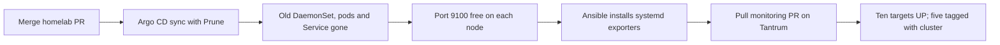

# Replace the K3s Node Exporter DaemonSet with systemd

Scope: Tombstone, Whyachi, Biteforce, Huge and Minotaur. The existing five VM/Proxmox
targets stay in place. Kubernetes workloads keep running; node OS metrics have a
gap between stopping the DaemonSet and starting each host service.



## 1. Prepare before stopping anything

Have working Kubernetes/Argo CD access and SSH/sudo access to all five nodes.
Use a checkout of the homelab PR for these read-only previews, from `ansible/`:

```bash
ansible-playbook playbooks/node-exporter/main.yml --syntax-check
ansible-playbook playbooks/node-exporter/main.yml --list-hosts
ansible-playbook playbooks/node-exporter/main.yml --limit 'control_planes:workers' --list-hosts
ansible 'control_planes:workers' -m ansible.builtin.ping
```

Expect ten hosts in the full play and five in the limited play. Use your existing
Vault/sudo options where needed, as described in [README.md](README.md#run-from-ansible).
Do not run the installation yet: the old exporter still owns port 9100.

The checked-in `monitoring` Argo CD Application uses manual sync. Check the live
app's Sync Policy too: if auto-sync/prune was enabled separately, merging can
trigger removal immediately. Merge the homelab PR when ready for this handoff.

## 2. Remove the old resources through Argo CD

After merging the homelab PR, refresh the **monitoring** application in Argo CD.
Review **Diff**, then **Sync with Prune enabled**. Expected deletions:

| Resource | Namespace | Why it goes |
| --- | --- | --- |
| DaemonSet `node-exporter` | `monitoring` | Host systemd services replace its pods |
| Service `node-exporter` | `monitoring` | No cluster discovery path is needed |

The PR also removes the old Node Exporter scrape job and its shared network-policy
entries. Replacement of the generated Prometheus scrape ConfigMap and its server
rollout are expected. Keep the other monitoring resources, including kube-state-metrics
and Fluent Bit. The old exporter has no PVC or separate ConfigMap; no host files
need deleting.

CLI alternative, with an authenticated Argo CD CLI:

```bash
argocd app get monitoring --hard-refresh
argocd app diff monitoring
argocd app sync monitoring --prune
argocd app wait monitoring --sync --timeout 180
```

Review the diff before running sync; `app diff` returns nonzero when differences exist.
Removing files from Git or running `kubectl apply -k` alone does not delete the old
resources. Deleting only pods makes the DaemonSet recreate them.

Confirm removal, using your intended kubeconfig/context:

```bash
kubectl -n monitoring get daemonset/node-exporter service/node-exporter --ignore-not-found
kubectl -n monitoring get pods -l app.kubernetes.io/name=node-exporter
```

Expect no resources from the first command and no pods from the second. If pods
are still terminating, wait for them to disappear before continuing.

## 3. Install the host services

Pull the merged homelab changes on the Ansible controller. From `ansible/`, check
that the old listener is gone:

```bash
ansible 'control_planes:workers' --become -m ansible.builtin.command -a "ss -ltnp 'sport = :9100'"
```

Expect only the socket-table header on each node. If a listener remains, identify
it before proceeding. The role also checks the port before installation/start and
refuses a healthy endpoint without a recognized running systemd exporter.

Preview and install one node first:

```bash
ansible-playbook playbooks/node-exporter/main.yml --limit tombstone --check --diff
ansible-playbook playbooks/node-exporter/main.yml --limit tombstone
```

After success, run the five-node group; the already completed node is safe to rerun:

```bash
ansible-playbook playbooks/node-exporter/main.yml --limit 'control_planes:workers'
ansible 'control_planes:workers' --become -m ansible.builtin.command -a 'systemctl is-active prometheus-node-exporter.service'
```

Expect `active` on all five. The play processes one node at a time and verifies
metrics locally and from Tantrum. It binds each service to its inventory IP on
port 9100; it does not change firewall rules. Distro versions/default collectors
can differ from the old container, so compare important disk/network metrics too.

## 4. Enable direct collection on Tantrum

Merge the companion `tantrum-monitoring` PR, then pull it in Tantrum's monitoring
checkout. This adds five entries to `apps/prometheus/config/targets/node-exporters.yml`.
Each gets its `host_name`, `host_type: linux-vm` and `cluster: k3s-homelab` labels.
Prometheus attaches these labels; no label configuration is needed on the exporters.

The existing `node-exporter` job watches this file: no image pull, restart or reload
is needed. Expect the targets within 30s, followed by a scrape within 15s.

In central Prometheus or Grafana Explore, both counts should match:

```promql
count(up{job="node-exporter"} == 1) # 10
count(up{job="node-exporter", cluster="k3s-homelab"} == 1) # 5
```

Also check `node_uname_info{job="node-exporter", cluster="k3s-homelab"}` returns all
five hosts. The old K3s Prometheus no longer collects Node Exporter metrics; use
Tantrum for them. The future Agent excludes this job and still collects internal
Kubernetes metrics. Its deployment is a separate step.

## If you need to restore the DaemonSet

Stop/disable native exporters on the five K3s nodes **before** restoring the
DaemonSet, so port 9100 is free:

```bash
ansible 'control_planes:workers' --become -m ansible.builtin.systemd_service -a 'name=prometheus-node-exporter.service state=stopped enabled=false'
```

Use the homelab PR's revert to restore the old manifests/configuration, then sync
`monitoring` in Argo CD and verify its DaemonSet pods are Ready. Do not run the
expanded host playbook while reverting. Central target addresses can stay: the
old DaemonSet exposes the same node IPs/port. Successful rollback needs only one
exporter per node.

References: [Argo CD pruning](https://argo-cd.readthedocs.io/en/stable/user-guide/auto_sync/#automatic-pruning),
[DaemonSet deletion](https://kubernetes.io/docs/concepts/workloads/controllers/daemonset/#clean-up).
