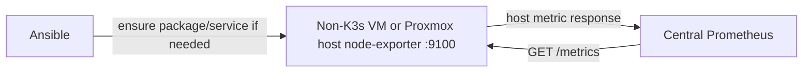

# Node Exporter for non-K3s VMs and Proxmox hosts

**Prepared playbook only; no rollout performed.** This is model 3 host metrics:
central Prometheus scrapes each VM/physical host's Node Exporter directly. It does not install
a Prometheus Agent, collect application business metrics, or change the live cluster.



## Selection and existing deployments

| Situation | Behavior |
| --- | --- |
| Inventory `control_planes` or `workers` | Excluded before any SSH/facts; existing K3s DaemonSet left alone |
| Other machine has K3s files/service-unit paths | Read-only detection, then skip; no exporter/service mutation |
| Healthy exporter on selected machine IP/port | Reuse it, whether native or containerized; no duplicate install |
| Recognized exporter service exists but is unhealthy/stopped | Start/enable that service; do not install another or rewrite its config; verify endpoint |
| Neither exporter nor known service exists | Ensure port is free, install Debian/Ubuntu package, bind to machine IP, enable/start |
| Unknown process owns port | Fail before installing; operator resolves the existing process |
| Already installed by this job | Keep package present, enforce its own listener drop-in, restart only on config changes |

Default inventory selection is **Valkyrie, Tantrum, Hydra, Endgame and Deep Six**. Hydra/OMV uses
its existing root account; its networking/storage configuration is not changed.
`proxmox_hosts` is included explicitly; existing Proxmox SSH accounts are reused.
The Pi is outside these groups and is not selected. Node Exporter measures the
physical Proxmox OS, not VM inventory/Proxmox API state; an API exporter is a separate future component.
New installs require Debian-family Linux and systemd. Other systems can reuse
an already healthy exporter. Distro package version is used, not an unverified
download of the latest upstream binary.

## Run from `ansible/`

```bash
ansible-playbook playbooks/node-exporter/main.yml --syntax-check
ansible-playbook playbooks/node-exporter/main.yml --list-hosts
ansible-playbook playbooks/node-exporter/main.yml --limit valkyrie --check --diff
ansible-playbook playbooks/node-exporter/main.yml --limit valkyrie
# Physical Proxmox host, same playbook:
ansible-playbook playbooks/node-exporter/main.yml --limit endgame --check --diff
ansible-playbook playbooks/node-exporter/main.yml --limit endgame
```

Use existing SSH/Vault setup (`-e @secrets/vault.yml --ask-vault-pass`) or
`--ask-become-pass` as appropriate. No passwords/keys are added to this job.
If a host uses a different sudo executable, override its existing inventory
setting; e.g. `-e ansible_sudo_exe=/usr/bin/sudo` where required.
One machine is processed at a time; failures stop the rollout. No `--limit` selects
all eligible VMs/Proxmox hosts. Check mode is read-only: it can inspect existing endpoints,
but does not prove a future install/start. New drop-in rendering/start and
post-install reachability checks are skipped where they cannot run in check mode.

## Settings and files

| Setting | Default / use |
| --- | --- |
| `node_exporter_listen_address` | Inventory `network_address`, falling back to numeric `ansible_host` for Proxmox hosts; concrete IPv4, not `0.0.0.0` |
| `node_exporter_port` | 9100 |
| `node_exporter_verify_from` | `tantrum`; read-only HTTP probe from monitoring VM; `''` disables |
| `node_exporter_known_services` | Distro, `node_exporter`, `node-exporter` systemd unit names |
| Package/service/binary | `prometheus-node-exporter`, corresponding service, `/usr/bin/prometheus-node-exporter` |
| Role `defaults/main.yml` | Inventory and `-e` can override these defaults |
| Role tasks | Detect/reuse/install, then verify endpoint and network |
| `20-homelab-listen.conf` template | Managed drop-in under the distro service; only for this job's installation |

No VM power, Proxmox API, quorum, storage or cluster settings are changed.

Package auto-start is suppressed during a new install so a default all-interface
listener is not started before the machine-IP override is applied. An unrelated
existing exporter configuration is not taken over. If it is loopback-only or
uses another port, correct its own settings or select the right port; this job
fails verification rather than silently installing a duplicate.

No firewall rules are changed. Allow the monitoring VM to reach this private
TCP port according to your firewall policy. The endpoint is HTTP and contains
host details; it has no authentication added by this job.

## After running

Local checks require both `node_exporter_build_info` and `node_uname_info`.
The optional delegated probe proves the monitoring VM can retrieve the endpoint,
not that the Prometheus container already scrapes it. Add the reported target to
central Prometheus and verify Targets/queries separately. Re-running a successful
unchanged job should not restart the service.
