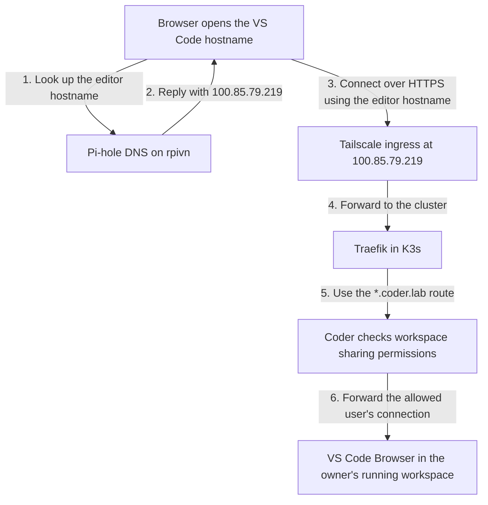

# Coder

`https://coder.lab` → Coder Community → one persistent workspace per repository.
Browser and desktop VS Code connect to the same files. Git push triggers existing CI/CD.

| Component | Configuration |
| --- | --- |
| Coder | Official chart/image `2.38.6`; 1 replica; request 1 CPU / 2 GiB RAM |
| Database | Existing `postgres.postgres.svc.cluster.local:5432`; database `coder`, role `coder_user` |
| Workspace | AMD64 worker; request 1 CPU / 2 GiB, limit 2 CPU / 4 GiB; 20 GiB Longhorn home |
| Access | Traefik + `infisical-acme` for `coder.lab`; `*.coder.lab` with `homelab-ca` for workspace browser apps |
| Secrets | ESO `ClusterSecretStore/infisical`; no credentials in Git |

**Commands below are manual rollout steps after PR review and merge.** Run from
the repository root in WSL/Linux with `kubectl`, `argocd`, and `curl`.
The Application has no automated sync. No new PostgreSQL instance is installed.

## 1. Prerequisites

```bash
kubectl config current-context                 # Confirm the intended cluster.
kubectl get nodes -L kubernetes.io/arch,node-role.kubernetes.io/control-plane
kubectl get storageclass longhorn
kubectl -n postgres get statefulset/postgres service/postgres
kubectl get clustersecretstore infisical
kubectl get clusterissuer infisical-acme
```

Increase worker RAM first; allow at least 4 GiB of free schedulable RAM for Coder
and one workspace, plus headroom for builds and existing workloads. Longhorn
storage requests consume additional physical space according to replica count.

Add `coder.lab` in Pi-hole pointing to the same reachable Traefik address as
`grafana.lab`. Devices need the existing lab DNS, CA trust, and LAN/Tailscale access.
For VS Code Browser on shared workspaces, follow [Shared workspace access](#shared-workspace-access).

## 2. Create the database and role once

```bash
# Uses the existing admin identity inside PostgreSQL; no credential export.
kubectl -n postgres exec -it postgres-0 -- \
  sh -c 'exec psql -U "$POSTGRES_USER" -d "$POSTGRES_DB" -v ON_ERROR_STOP=1'
```

At the `psql` prompt:

```sql
CREATE ROLE coder_user LOGIN NOSUPERUSER NOCREATEDB NOCREATEROLE NOREPLICATION;
\password coder_user
-- Enter a new password at the hidden prompts; retain it in Infisical.
CREATE DATABASE coder OWNER coder_user;
REVOKE ALL ON DATABASE coder FROM PUBLIC;
GRANT CONNECT, TEMPORARY ON DATABASE coder TO coder_user;
\connect coder
REVOKE ALL ON SCHEMA public FROM PUBLIC;
GRANT ALL ON SCHEMA public TO coder_user;
\quit
```

In the existing Infisical `k3s-j0tn` / `dev` project, add:

```text
Path:  /coder
Key:   CODER_PG_CONNECTION_URL
Value: postgres://coder_user:<URL-encoded-password>@postgres.postgres.svc.cluster.local:5432/coder?sslmode=disable
```

Percent-encode special characters in the password. `sslmode=disable` matches
the existing PostgreSQL service, which has no TLS configuration. Only the Coder
server pods are added to its existing PostgreSQL ingress allowlist.

## 3. Publish prerequisites, then manually sync Coder

```bash
kubectl apply -f apps/coder/manifests/00-namespaces.yaml

# Existing apps pick up the reviewed PKI distribution, DB allowlist and human RBAC.
argocd app sync cert-manager
kubectl wait --for=condition=Synced bundle/coder-trust-bundle --timeout=180s
kubectl -n coder get configmap coder-trust-bundle
kubectl -n coder-workspaces get configmap coder-trust-bundle
argocd app sync postgres
argocd app sync rbac

kubectl apply -f apps/coder/argocd-app.yaml
argocd app sync coder
kubectl -n coder wait --for=condition=Ready externalsecret/coder-db --timeout=180s
kubectl -n coder rollout status deployment/coder --timeout=300s
kubectl -n coder wait --for=condition=Ready certificate/coder-lab-tls --timeout=300s
```

Open `https://coder.lab` and create the first admin account. This initial setup
uses Coder password authentication; Keycloak application SSO is not configured.

## 4. Publish the repository workspace template

```bash
# Use the lab roots for CLI HTTPS verification; do not disable verification.
export SSL_CERT_FILE="$PWD/pki/bundles/application-trust.pem"
mkdir -p "$HOME/.local/bin"
curl --cacert "$SSL_CERT_FILE" -fL https://coder.lab/bin/coder-linux-amd64 \
  -o "$HOME/.local/bin/coder"
chmod +x "$HOME/.local/bin/coder"
export PATH="$HOME/.local/bin:$PATH"  # CLI downloaded from this server matches its version.
coder login https://coder.lab
coder publickey
# Add that public key to GitHub → Settings → SSH and GPG keys before private clones.
coder templates push homelab-repo --directory apps/coder/template
```

In Coder: **Create workspace → homelab-repo**. Name it after the repository and
enter an HTTPS public-repo URL or SSH URL such as
`git@github.com:Quangsumi/k3s-homelab.git`. Open **VS Code Browser** or **VS Code Desktop**.
Desktop access requires local VS Code and the Coder extension.

The template clones once to `/home/coder/project`; it never automatically pulls,
resets, or overwrites existing Git work. The image includes the editor and basic
tools; for language-specific runtimes, publish a derived image with those tools
and set template variable `workspace_image` to its pinned tag/digest.

## 5. Verify persistence

```bash
# In the workspace terminal:
printf 'persistence-check\n' > /home/coder/persistence-check.txt
git status
```

Stop/start this workspace from the portal. Open it from a second device and
confirm the file and any saved uncommitted edits remain. `/home/coder` is on the
PVC; files elsewhere may disappear when the container is replaced. Stopping
preserves the PVC; **deleting a workspace deletes its PVC**. Back up workspace
volumes and the `coder` database; Git does not contain unpushed work.

```bash
# If startup fails:
kubectl -n coder logs deployment/coder --tail=100
kubectl -n coder-workspaces get pods,pvc
kubectl -n coder-workspaces describe pod <workspace-pod>
```

## Shared workspace access

Coder gives each browser editor its own hostname under `coder.lab`. That
isolates the editor from the dashboard in the browser, which lets Coder grant
access to collaborators. Pi-hole answers DNS lookups so the browser knows which
IP to connect to. One wildcard rule covers all the editor hostnames.



### 1. Check Pi-hole DNS

Both domain should return the same IP

```bash
nslookup coder.lab       # Find the IP used by the Coder dashboard.
nslookup test.coder.lab  # Check whether a subdomain gets the same IP.
```

### 2. Sync Coder and share the workspace

1. After merging, sync **coder** in Argo CD. The wildcard Ingress sends editor
   requests to Coder. cert-manager issues its certificate from the existing
   `homelab-ca` ClusterIssuer. The collaborator's browser needs to trust the
   [Homelab v1 root](../../pki/public/homelab-root-v1.crt) for that hostname.

   ```bash
   kubectl wait --for=condition=Ready clusterissuer/homelab-ca --timeout=180s
   argocd app sync coder
   kubectl -n coder wait --for=condition=Ready certificate/coder-workspace-apps --timeout=180s
   kubectl -n coder rollout status deployment/coder --timeout=300s
   ```

2. Publish `homelab-multi-repo-template.zip` as a **new version of the existing
   template** and select **Update** on the existing workspace so it picks up the
   new VS Code Browser URL. Updating restarts the workspace.
3. As workspace owner, select **Share**, add the collaborator, and grant **Use**.
   Have them sign in as themselves and open **Workspaces → Shared → your
   workspace → VS Code Browser**. The editor URL should now be under `*.coder.lab`.
   The **Use** role includes access to the workspace files and terminal.

## Local validation (no cluster access)

```bash
helm template coder coder --repo https://helm.coder.com/v2 --version 2.38.6 \
  --namespace coder -f apps/coder/values.yaml > /tmp/coder-rendered.yaml
kustomize build apps/coder/manifests
kustomize build apps/postgres
kustomize build infrastructure/cert-manager
kustomize build rbac
terraform -chdir=apps/coder/template init -backend=false
terraform -chdir=apps/coder/template validate
```
