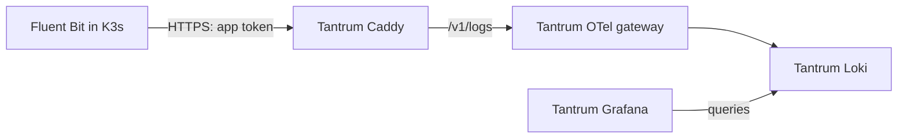

# Move pod logs to Tantrum

Prepared for manual review and rollout. This PR changes the pod-log destination;
it leaves profiles, node assignments, local state and old backends in place.



## Before replacing any collector

1. Tantrum's proxy, OTel gateway and Loki must be running. Pods need a network
   path to `192.168.63.66:443`; the existing Fluent Bit NetworkPolicy controls
   incoming metrics requests only and is left unchanged.
2. In Infisical, create **`/otel-gateway/APP_BEARER_TOKEN`** using the exact contents
   of Tantrum's `apps/otel-gateway/secrets/otel-app-otlp-bearer-token`.
   Use the raw value, without `Bearer `. Do not change the old `EXTERNAL_BEARER_TOKEN`
   or use the host token. This reuses the new gateway's credential, not a new rotation.
3. Confirm the destination in [gateway.env](gateway.env). The IP avoids the old
   wildcard DNS destination; the HTTP/TLS name remains `otel.tantrum.lab`.

From the repository root on your Linux/WSL controller, test certificate and app
authentication with an empty request. No log is inserted. Expected codes: **401**,
then **200**. These checks prove access from this controller; the first node trial
must also prove pod-to-VM access.

```bash
curl --noproxy '*' --silent --show-error --max-time 15 \
  --cacert pki/public/tantrum-caddy.crt \
  --resolve otel.tantrum.lab:443:192.168.63.66 \
  -H 'Content-Type: application/json' --data '{}' \
  --output /dev/null --write-out '%{http_code}\n' https://otel.tantrum.lab/v1/logs
read -rsp 'Tantrum app token: ' OTEL_GATEWAY_APP_BEARER_TOKEN
curl --noproxy '*' --silent --show-error --max-time 15 \
  --cacert pki/public/tantrum-caddy.crt \
  --resolve otel.tantrum.lab:443:192.168.63.66 \
  -H 'Content-Type: application/json' \
  -H "Authorization: Bearer ${OTEL_GATEWAY_APP_BEARER_TOKEN}" --data '{}' \
  --output /dev/null --write-out '%{http_code}\n' https://otel.tantrum.lab/v1/logs
unset OTEL_GATEWAY_APP_BEARER_TOKEN
```

## Publish, then move one node

Keep automatic sync/pruning off during the trial. Do not prune old Fluent Bit
ConfigMaps, gateway settings ConfigMaps or CA ConfigMaps while pods still use them.
Merge/review first, then use your normal manual Argo CD sync or apply only this app:

```bash
kubectl kustomize apps/monitoring/fluent-bit
kubectl apply -k apps/monitoring/fluent-bit
kubectl -n monitoring wait --for=condition=Ready externalsecret/otel-gateway-app-auth --timeout=120s
```

Check the first command's rendered YAML before applying. Publishing changes the
DaemonSet template, but `OnDelete` leaves current collectors running their old
settings. A pod recreated for any reason will use the new settings.

Example: find Whyachi's collector, then delete **only that pod**:

```bash
kubectl -n monitoring get pods -l app.kubernetes.io/name=fluent-bit --field-selector=spec.nodeName=whyachi
kubectl -n monitoring delete pod <whyachi-fluent-bit-pod-name>
kubectl -n monitoring get pods -w -l app.kubernetes.io/name=fluent-bit --field-selector=spec.nodeName=whyachi
```

Wait for Ready, then stop watching with Ctrl+C. Generate a fresh log from an
existing application on Whyachi and find its unique text/recent timestamp in
Tantrum Grafana → Pod Logs. Check namespace, pod, container, message and time;
check the new collector's logs for connection/authentication errors. Readiness
alone does not prove delivery. Repeat one node at a time only after that succeeds.

Keep the selected profiles and `/var/lib/fluent-bit/pods` unchanged. This
destination-only change needs no bookmark reset, NEW maintenance Job or queue
deletion. Disk queues can send older waiting messages to Tantrum. RAM profiles
can lose waiting messages during replacement. The old gateway may still drain
previously accepted messages into the old Loki.

## Metadata limits

Fluent Bit still collects pod metadata. Tantrum promotes pod UID/name/IP,
namespace, node and container fields, and adds the cluster name.
Its optional Kubernetes lookup is currently disabled. Deployment, StatefulSet,
DaemonSet names and promoted app labels are not guaranteed to match the old
gateway. Verify Grafana's service filter as well as the basic fields; do not
call this full label parity until tested. If those additional fields are needed,
validate the existing optional gateway enrichment setup with restricted cluster
credentials as a separate change. No cluster credentials are added to the VM here.

## What stays, and when old backends can stop

| Keep in K3s | Purpose |
| --- | --- |
| Fluent Bit + its ServiceAccount/RBAC | Pod files and Kubernetes metadata |
| Node Exporter | Node OS metrics |
| kube-state-metrics | Kubernetes object state |
| Prometheus Agent, after deployment | Scrape cluster targets and remote-write to Tantrum |
| Namespace and metrics access rules | Support the collectors/exporters |

Keep the current Prometheus until its Agent replacement is verified. The Agent
is still prepared configuration, not a workload introduced by this PR.
Keep core metrics-server for `kubectl top`/autoscaling.

After pod-log delivery is verified, move any app SDK logs/traces/metrics still
using the old gateway. Then verify the new metrics route and drain pending
queues before retiring old Grafana, Loki, Jaeger, Prometheus server/login proxy,
gateway and any unused Aspire instance. Make retirement a separate desired-state
change in Git; do not delete the whole monitoring namespace or prune storage here.

## Roll back a trial node

Publish the previous reviewed Fluent Bit manifests/config from the old revision,
then replace only that node's collector again. Keep the old gateway and token
available until migration is accepted. Preserve disk state; already delivered
data stays in its destination and an unread/replayed range may produce duplicates.
Do not restore unrelated old resources over the whole monitoring namespace.
