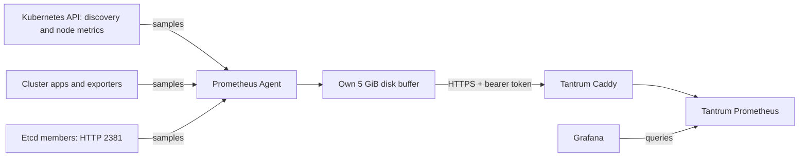

# Prometheus Agent — Kubernetes metrics to Tantrum

**Prepared for manual rollout.** One Agent scrapes inside K3s and forwards samples
to Tantrum Prometheus. The old K3s server stays available during verification.

## Decisions

| Before | This change | Reason |
| --- | --- | --- |
| Full server stores/query metrics in K3s | Separate `prometheus-agent` StatefulSet; Tantrum stores/queries | Verify before retiring the old server |
| Agent config prepared in the Docker repo | This app owns deployed config | One source of truth next to its workload |
| Scheduler/controller data mixed into API-server job | Named jobs with separate metric filters on each server's HTTPS `6443/metrics` | K3s shares a registry; avoid opening 10257/10259 or storing the same families twice |
| Etcd metrics bound to localhost | Scrape each etcd member's private IP on HTTP 2381 | Needs the manual K3s setting in [INIT.md](INIT.md); no etcd client keys in the pod |
| Node Exporters managed on hosts | Same direct Tantrum scraping | Agent never collects Node Exporters |

## Files and behavior

| File | Used for |
| --- | --- |
| `statefulset.yaml` | Image `prom/prometheus:v3.15.1`, Agent flags, config validation, own disk and mounts |
| `config/prometheus.yml` | Loads `scrapes/*.yml`; cluster label on all outgoing samples; named remote-write queue |
| `config/scrapes/kubernetes.yml` | kube-state-metrics, kubelet, cAdvisor |
| `config/scrapes/control-plane.yml` | API server, scheduler, controller/workqueues and embedded etcd |
| Other `config/scrapes/*.yml` | Existing app, storage, network, certificate, Argo CD, External Secrets and Fluent Bit jobs |
| `kustomization.yaml` | Whole files become ConfigMap keys; changed generated names roll the pod |
| `remote-write-external-secret.yaml` | Infisical `/prometheus/REMOTE_WRITE_BEARER_TOKEN` → Secret → `secrets/remote-write/token` |
| `litellm-external-secret.yaml` | Existing LiteLLM credential, moved here unchanged so Agent outlives the old server folder |
| `rbac.yaml` | Own account; discovery, API `/metrics` and node-proxy access; no admin kubeconfig or Secret-read permission |
| `service.yaml`, `network-policy.yaml` | Private 9095 diagnostic UI; use authenticated port-forward |

Kubernetes projects the main config, each job file, credentials and the existing
`tantrum-caddy-trust-bundle` ConfigMap into `/etc/prometheus`. Prometheus itself
loads the listed job files. Nothing discovers/merges arbitrary files automatically.

## Connections

| Direction | Address / purpose |
| --- | --- |
| Out | Kubernetes API 443; discovered servers 6443 for component metrics |
| Out | API node-proxy paths for kubelet/cAdvisor; discovered in-cluster metrics ports |
| Out | Etcd node private IPs, HTTP 2381; metric names restricted to `etcd_*` |
| Out | `https://metrics-write.tantrum.lab/api/v1/write`, TCP 443; existing VM token + Tantrum root |
| In | Private 9095 health/targets/Agent self-metrics; no public ingress or host port |

`hostAliases` pins the write hostname to `192.168.63.66`, preserving HTTP Host and
TLS name while avoiding the old wildcard DNS route. Update it if Tantrum moves.
Existing scrape-target policies allow both old/new scrapers. As with the old
server, this app does not add an egress restriction.

## Resources, storage and failure

- Main container keeps the old K3s baseline: **100m CPU / 576 MiB requested, 1 GiB
  memory limit**, no CPU limit. Validation init container requests 50m / 64 MiB,
  capped at 256 MiB; it exits before scraping starts.
- Own **5 GiB Longhorn PVC**, same class/size as the old server, stores the Agent
  write-ahead log (disk buffer). Existing metric history is not copied.
- `--storage.agent.retention.max-time=4h` caps pending-sample age; disk space can
  run out sooner. A healthy pod does not prove samples are reaching Tantrum.
- One replica: Agent downtime loses scrapes. Its disk buffer survives pod replacement
  and scale-down/deletion; do not run two replicas against the same disk.
- No historical queries, recording rules or alert evaluation in Agent mode.
  Config changes roll through Kustomize; after credential/CA changes, restart the
  Agent if needed and recheck sending.

For another cluster, deploy its own Agent/account/disk and change the cluster
labels in the main config/job files, destination/token/trust and write-host address. For new in-cluster apps,
add the relevant scrape job and target ingress permission here.

Follow [INIT.md](INIT.md), then [VERIFY.md](VERIFY.md). The latter records the live
read-only discovery and the exact rollout checks.

Sources: [K3s shared metrics registry](https://docs.k3s.io/reference/metrics),
[etcd exposure flag](https://docs.k3s.io/cli/server#database),
[Prometheus Agent](https://prometheus.io/docs/prometheus/latest/prometheus_agent/).
