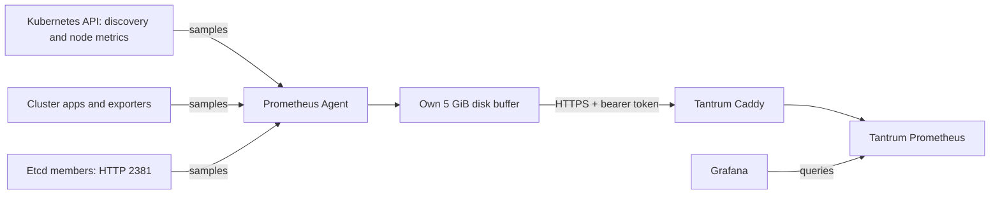

# Prometheus Agent — Kubernetes metrics to Tantrum

**Prepared for manual rollout.** One Agent scrapes inside K3s and forwards samples
to Tantrum Prometheus. The old K3s server stays available during verification.

## Decisions

| Before | This change | Reason |
| --- | --- | --- |
| Full server stores/query metrics in K3s | Separate `prometheus-agent` StatefulSet; Tantrum stores/queries | Verify before retiring the old server |
| Agent config prepared in the Docker repo | This app owns deployed config | One source of truth next to its workload |
| Scheduler/controller data mixed into API-server job | Named jobs with separate metric filters on each server's HTTPS `6443/metrics` | K3s shares a registry; avoid opening 10257/10259 or storing the same families twice |
| Etcd metrics bound to localhost | Scrape each etcd member's private IP on HTTP 2381 | Needs the manual K3s setting in [INIT.md](INIT.md); no etcd client keys in the pod |
| Node Exporters managed on hosts | Same direct Tantrum scraping | Agent never collects Node Exporters |

## Files and behavior

| File | Used for |
| --- | --- |
| `statefulset.yaml` | Image `prom/prometheus:v3.15.1`, Agent flags, config validation, own disk and mounts |
| `config/prometheus.yml` | Loads `scrapes/*.yml`; cluster label on all outgoing samples; named remote-write queue |
| `config/scrapes/kubernetes.yml` | kube-state-metrics, kubelet, cAdvisor |
| `config/scrapes/control-plane.yml` | API server, scheduler, controller/workqueues and embedded etcd |
| Other `config/scrapes/*.yml` | Existing app, storage, network, certificate, Argo CD, External Secrets and Fluent Bit jobs |
| `kustomization.yaml` | Explicit `KEY=Git/path` entries; e.g. `kubernetes.yml=config/scrapes/kubernetes.yml`. Changed generated names roll the pod |
| `remote-write-external-secret.yaml` | Infisical `/prometheus/REMOTE_WRITE_BEARER_TOKEN` → Secret → `secrets/remote-write/token` |
| `../prometheus/manifest.yaml` | Existing LiteLLM ExternalSecret stays in its original location; both collectors read its generated Secret |
| `rbac.yaml` | Own account; discovery, API `/metrics` and node-proxy access; no admin kubeconfig or Secret-read permission |
| `service.yaml`, `network-policy.yaml` | Private 9095 diagnostic UI; use authenticated port-forward |

Read [the explicit key examples](kustomization.yaml) and
[the container file tree directly above `volumes`](statefulset.yaml) together:

1. Parent `apps/monitoring/kustomization.yaml` includes this app's Kustomization.
   Kustomize reads its listed Git files and builds ConfigMap YAML; Argo CD creates
   those objects in Kubernetes.
2. External Secrets reads Infisical and creates Secrets. trust-manager supplies
   the CA ConfigMap. These controllers run independently; the pod waits if a
   required object/key is missing.
3. `volumes.name: config` chooses object keys and gives each a relative file path.
   `volumeMounts.name: config` mounts that SAME volume at `/etc/prometheus`.
4. The validator reads those files first. Then `--config.file` opens
   `/etc/prometheus/prometheus.yml`; its `scrape_config_files` opens the job files.
   `credentials_file` and `ca_file` open the particular credential/certificate files.

| Starts at | Kubernetes object + key | Container file / reader |
| --- | --- | --- |
| Git `config/prometheus.yml` | ConfigMap `prometheus-agent-config`: `prometheus.yml` | `/etc/prometheus/prometheus.yml`; startup argument |
| Git `config/scrapes/kubernetes.yml` | ConfigMap `prometheus-agent-scrapes`: `kubernetes.yml` | `/etc/prometheus/scrapes/kubernetes.yml`; main config's `scrapes/*.yml` |
| Infisical `/prometheus/REMOTE_WRITE_BEARER_TOKEN` | ExternalSecret → Secret `prometheus-agent-remote-write-token`: `token` | `/etc/prometheus/secrets/remote-write/token`; remote-write `credentials_file` |
| Infisical `/prometheus/LITELLM_MASTER_KEY` | Existing ExternalSecret → Secret `litellm-prometheus-job-secret-infisical`: `LITELLM_MASTER_KEY` | `/etc/prometheus/secrets/litellm/LITELLM_MASTER_KEY`; LiteLLM `credentials_file` |
| Git `pki/public/tantrum-caddy.crt` | PKI source → trust-manager → ConfigMap `tantrum-caddy-trust-bundle`: `tantrum-caddy.crt` | Renamed `/etc/prometheus/secrets/remote-write/ca.crt`; remote-write `ca_file` |
| ServiceAccount `prometheus-agent` | Kubernetes automatically supplies its API token + API CA | `/var/run/secrets/kubernetes.io/serviceaccount/token` and `ca.crt`; Kubernetes discovery/scrapes |

ConfigMaps store non-secret file contents; Secrets store private values.
An ExternalSecret is the instruction for fetching a value, not the value itself.
The container's `secrets/` folders are assembled by the volume; they need not exist
in Git. The WAL disk is separate: PVC `wal-prometheus-agent-0` mounts at `/prometheus`.

## Connections

| Direction | Address / purpose |
| --- | --- |
| Out | Kubernetes API 443; discovered servers 6443 for component metrics |
| Out | API node-proxy paths for kubelet/cAdvisor; discovered in-cluster metrics ports |
| Out | Etcd node private IPs, HTTP 2381; metric names restricted to `etcd_*` |
| Out | `https://metrics-write.tantrum.lab/api/v1/write`, TCP 443; existing VM token + Tantrum root |
| In | Private 9095 health/targets/Agent self-metrics; no public ingress or host port |

`hostAliases` adds `192.168.63.66 metrics-write.tantrum.lab` to this pod's
`/etc/hosts`. The URL keeps its hostname for Caddy's site selection and HTTPS
certificate verification. It avoids the old wildcard DNS route; remove the override
once cluster DNS returns this VM IP, or update it if Tantrum moves.

`clusterIP: None` means this Service's DNS returns pod IPs directly, without a
separate Service IP. It supplies the StatefulSet's stable pod name; it does not
restrict who can connect. The `prometheus-agent-private-ui` NetworkPolicy provides
that separate restriction: block direct incoming pod connections to diagnostics.
It is not required to scrape/send metrics; outgoing requests, node health probes
and authenticated port-forward still work.
Existing scrape-target policies allow both old/new scrapers. As with the old
server, this app does not add an egress restriction.

## Resources, storage and failure

- Main container keeps the old K3s baseline: **100m CPU / 576 MiB requested, 1 GiB
  memory limit**, no CPU limit. Validation init container requests 50m / 64 MiB,
  capped at 256 MiB; it exits before scraping starts.
- Own **5 GiB Longhorn PVC**, same class/size as the old server, stores the Agent
  write-ahead log (disk buffer). Existing metric history is not copied.
- `--storage.agent.retention.max-time=4h` caps pending-sample age; disk space can
  run out sooner. A healthy pod does not prove samples are reaching Tantrum.
- One replica: Agent downtime loses scrapes. Its disk buffer survives pod replacement
  and scale-down/deletion; do not run two replicas against the same disk.
- No historical queries, recording rules or alert evaluation in Agent mode.
  Config changes roll through Kustomize; after credential/CA changes, restart the
  Agent if needed and recheck sending.

Keep both retention settings; they act on different deletions:

| Setting | Trigger | Kept |
| --- | --- | --- |
| StatefulSet `whenDeleted/whenScaled: Retain` | Delete the StatefulSet or scale it down | PVC (disk claim), still bound to its disk |
| Longhorn StorageClass `reclaimPolicy: Retain` | Explicitly delete that PVC | PV/backing disk, requiring manual recovery or cleanup |

The Longhorn Helm values already configure `persistence.reclaimPolicy: Retain` in
`infrastructure/longhorn/argocd-app.yaml`. That does not update previously created
PVs automatically. Check the actual bound PV when verifying; retention is not a backup.

For another cluster, deploy its own Agent/account/disk and change the cluster
labels in the main config/job files, destination/token/trust and write-host address. For new in-cluster apps,
add the relevant scrape job and target ingress permission here.

Follow [INIT.md](INIT.md), then [VERIFY.md](VERIFY.md). The latter records the live
read-only discovery and the exact rollout checks.

Sources: [K3s shared metrics registry](https://docs.k3s.io/reference/metrics),
[etcd exposure flag](https://docs.k3s.io/cli/server#database),
[Prometheus Agent](https://prometheus.io/docs/prometheus/latest/prometheus_agent/).
Storage semantics: [StatefulSet PVC retention](https://kubernetes.io/docs/concepts/workloads/controllers/statefulset/#persistentvolumeclaim-retention),
[PV reclaim policy](https://kubernetes.io/docs/concepts/storage/persistent-volumes/#reclaiming).
