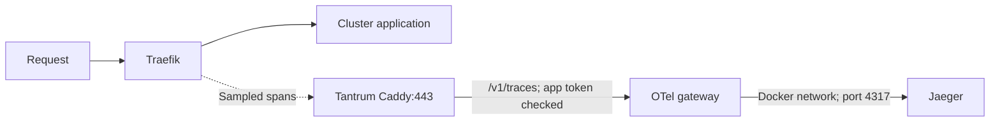

# Traefik

Dashboard: <https://traefik.lab/dashboard/>. Existing routing, Prometheus metrics,
three replicas and resource settings are retained.

## Traces

Previously, this repo enabled metrics but no trace export. Traefik now exports
about 10% of new HTTP requests to Tantrum. Requests with an incoming trace context
inherit its sampling decision. Internal health routes are excluded.



| File / setting | What it does |
| --- | --- |
| `kustomization.yaml` | Includes the ExternalSecret, HelmChartConfig and dashboard resources |
| `05-otel-gateway-app-auth.yaml` | Fetches Infisical `/otel-gateway/APP_BEARER_TOKEN`; creates `kube-system/otel-gateway-app-auth`, key `token` |
| `10-resource-config.yaml`, `env` | Reads that key into `OTEL_GATEWAY_APP_TOKEN` in each Traefik container |
| `10-resource-config.yaml`, `tracing` | Helm generates container arguments for HTTP export, sampling, service name and cluster attribute |
| `../../pki/20-tantrum-caddy-trust-bundle.yaml` | trust-manager copies the central Tantrum CA to `kube-system/tantrum-caddy-trust-bundle` |
| `10-resource-config.yaml`, `volumes` | Mounts that ConfigMap read-only at `/etc/traefik/tantrum-caddy-trust`; key `tantrum-caddy.crt` becomes a file of the same name |

The rendered argument contains `Authorization=Bearer $(OTEL_GATEWAY_APP_TOKEN)`.
Kubernetes substitutes the variable when starting the container; the real token
is not stored in Helm values. It is present in the running process environment
and arguments, so do not share process dumps.

Outbound: HTTPS to `otel.tantrum.lab:443/v1/traces`, verified using the mounted CA.
Uses normal pod DNS; it must resolve the name to `192.168.63.66`.
No new inbound port or Service is added. No request/response headers are explicitly
captured; query parameters retain Traefik's default redaction.

Why this approach: Traefik already supports tracing; no extra collector or sidecar
is needed. The existing gateway owns authentication, queueing and Jaeger delivery.
Traefik exports asynchronously, but its own pending spans are not a durable disk
queue. Gateway downtime can lose spans before they reach its persistent queue.

Next: instrument LiteLLM separately to see work inside the application. Traefik
alone shows the proxy's view, not application handlers or database queries.

## Apply and verify

1. Confirm Infisical `/otel-gateway/APP_BEARER_TOKEN` already matches Tantrum's
   `otel-app-otlp-bearer-token` file. Use the raw token, without `Bearer `.
2. Sync **cert-manager** first to publish the updated Bundle. Wait for the copy:

   ```bash
   kubectl wait --for=condition=Synced bundle/tantrum-caddy-trust-bundle --timeout=120s
   kubectl -n kube-system get configmap tantrum-caddy-trust-bundle
   ```

3. From the reviewed checkout, create/update only the ExternalSecret first.
   This avoids restarting Traefik before its credential exists:

   ```bash
   kubectl apply -f infrastructure/traefik/05-otel-gateway-app-auth.yaml
   kubectl -n kube-system wait --for=condition=Ready externalsecret/traefik-otel-gateway-app-auth --timeout=120s
   ```

4. Confirm pod DNS resolves the gateway correctly before the rollout:

   ```bash
   kubectl -n kube-system exec deployment/traefik -- nslookup otel.tantrum.lab
   ```

   Expect `192.168.63.66`. If this image lacks `nslookup`, use an existing pod
   with that tool. Fix DNS before continuing if it returns the old ingress IP.

5. Sync the Argo CD application managing `infrastructure/traefik`, or apply its
   Kustomization manually if this path is managed manually:

   ```bash
   kubectl apply -k infrastructure/traefik
   kubectl -n kube-system rollout status deployment/traefik --timeout=300s
   kubectl -n kube-system get pods -l app.kubernetes.io/name=traefik
   kubectl -n kube-system logs deployment/traefik --all-pods=true --since=10m --prefix
   ```

   K3s's Helm controller processes the HelmChartConfig before changing the
   Deployment. If rollout status finishes immediately, confirm the Deployment's
   arguments below; the Helm update may still be pending. Do not edit the generated
   Deployment directly.

   ```bash
   kubectl -n kube-system get deployment traefik -o jsonpath='{.spec.template.spec.containers[0].args}'
   ```

   Expect `tracing.sampleRate=0.1`, the HTTPS endpoint and the CA path. This shows
   the variable placeholder, not the expanded token. Check that all three replicas
   are Ready after the Helm update.

6. Make repeated requests through Traefik, for example open your app and navigate
   several pages. Then search **Jaeger → service `traefik` → last 15 minutes**.
   At 10% sampling, a few requests may produce no trace. Allow a few seconds for
   export; verify the route/backend and current timestamps.

| Symptom | Check |
| --- | --- |
| Pod cannot start | Secret and CA ConfigMap exist in `kube-system` |
| Export returns 401 | App token matches the gateway; not the host-log token |
| Certificate error | Correct Tantrum CA and DNS destination; keep certificate verification enabled |
| Timeout / connection refused | Pod DNS, LAN reachability to `192.168.63.66:443`, proxy/gateway running |
| No Jaeger traces | Requests actually pass through Traefik; sampling; errors from all three Traefik pods and gateway |

Token changes in Infisical update the Secret, but existing containers keep their
old environment values. After the Secret refreshes, run
`kubectl -n kube-system rollout restart deployment/traefik`.
Restart Traefik after replacing the CA too, so the exporter reloads its trust.

Rollback: revert the tracing PR and sync Traefik. It rolls back the trace settings;
no Jaeger history needs to be deleted. Remove the Secret/CA dependency only after
the consuming pods have rolled back.

References: [Traefik tracing settings](https://doc.traefik.io/traefik/reference/install-configuration/observability/tracing/),
[Kubernetes variable substitution in arguments](https://kubernetes.io/docs/tasks/inject-data-application/define-command-argument-container/#use-environment-variables-to-define-arguments).
