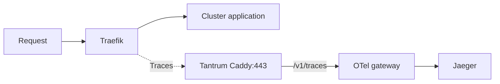

# Traefik

Dashboard: <https://traefik.lab/dashboard/>.

## Traces

`sampleRate: 1.0` records every new request. If an upstream application already
chose not to record a trace, Traefik follows that choice.
`addInternals: false` excludes Traefik's own services, such as health checks and
the dashboard.



## Apply and verify

1. Confirm Infisical `/otel-gateway/APP_BEARER_TOKEN` matches Tantrum's
   `otel-app-otlp-bearer-token` file. Store the raw token, without `Bearer `.
2. Sync **cert-manager**, then confirm the CA is available:

   ```bash
   kubectl wait --for=condition=Synced bundle/tantrum-caddy-trust-bundle --timeout=120s
   kubectl -n kube-system get configmap tantrum-caddy-trust-bundle
   ```

3. Prepare the Secret before updating Traefik:

   ```bash
   kubectl apply -f infrastructure/traefik/05-otel-gateway-app-auth.yaml
   kubectl -n kube-system wait --for=condition=Ready externalsecret/traefik-otel-gateway-app-auth --timeout=120s
   ```

4. Check DNS from a Traefik pod. Expect `192.168.63.66`:

   ```bash
   kubectl -n kube-system exec deployment/traefik -- nslookup otel.tantrum.lab
   ```

   If `nslookup` is unavailable, use another existing pod with that tool.

5. Sync the Argo CD application managing Traefik, or apply manually:

   ```bash
   kubectl apply -k infrastructure/traefik
   ```

   K3s's Helm controller updates the Deployment. Wait until its arguments show
   `tracing.sampleRate=1`, the gateway HTTPS endpoint and the CA path:

   ```bash
   kubectl -n kube-system get deployment traefik -o jsonpath='{.spec.template.spec.containers[0].args}'
   kubectl -n kube-system rollout status deployment/traefik --timeout=300s
   kubectl -n kube-system get pods -l app.kubernetes.io/name=traefik
   ```

6. Open an app through Traefik. Search **Jaeger → service `traefik` → last
   15 minutes** for a fresh trace. For export errors, check all Traefik pods:

   ```bash
   kubectl -n kube-system logs deployment/traefik --all-pods=true --since=10m --prefix
   ```

| Problem | Check |
| --- | --- |
| Pod cannot start | Secret and CA ConfigMap exist in `kube-system` |
| Export returns 401 | App token matches the gateway |
| Certificate error | Tantrum CA and DNS destination |
| Timeout | Connectivity to `192.168.63.66:443`; proxy and gateway running |

After changing the token or CA, wait for its Kubernetes copy to update, then run:

```bash
kubectl -n kube-system rollout restart deployment/traefik
```

Rollback: revert this PR and sync Traefik. Let its pods roll back before removing
the Secret or CA dependency.
