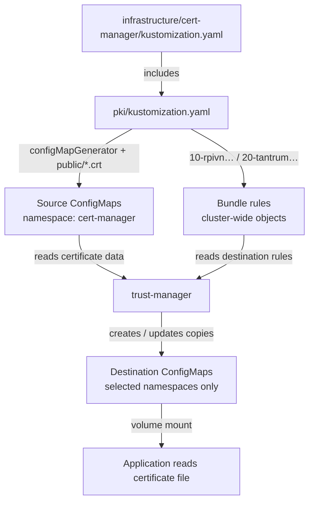

# Public certificate reference

Public certificates only. This is the central source for certificate files and
Kubernetes distribution rules. Hosts use the [Ansible certificates job](../ansible/playbooks/certificates/README.md)
or their app's playbook; Kubernetes uses the already installed trust-manager.

## Kubernetes certificate flow

**One sync/apply of `infrastructure/cert-manager` includes `pki/`.** Kustomize
builds the YAML first; applying it creates the sources and distribution rules.
Then the running trust-manager creates the destination ConfigMaps.



| Source ConfigMap in `cert-manager` | Bundle name = destination ConfigMap name | Destination namespaces | Data key in destination |
| --- | --- | --- | --- |
| `caddy-root-ca` (`ca.crt`) | `caddy-trust-bundle` | `argocd`, `external-secrets`, `postgres`, `monitoring`, `longhorn-system`, `litellm` | `ca-bundle.pem` |
| `tantrum-caddy-root-source` (`ca.crt`) | `tantrum-caddy-trust-bundle` | `monitoring`, `kube-system` | `tantrum-caddy.crt` |
| `homelab-application-roots` (`ca-bundle.pem`) + `caddy-root-ca` (`ca.crt`) + public Internet CAs | `coder-trust-bundle` | `coder`, `coder-workspaces` | `ca-bundle.pem` |

**Names:** `configMapGenerator.name` names the source; `Bundle.metadata.name`
names the destination; `namespaceSelector` chooses its namespaces. Source
ConfigMaps stay in `cert-manager`; trust-manager writes separate destination ConfigMaps.
The Rpivn bundle also includes public Internet CAs; Tantrum's contains only its root.

For Fluent Bit: `monitoring/tantrum-caddy-trust-bundle` → key `tantrum-caddy.crt`
→ mounted file `/fluent-bit/gateway-ca/tantrum-caddy.crt` → `TLS.CA_File`.

**Order:** publish PKI through cert-manager → wait for Bundle `Synced` → deploy/recreate
the consuming pod. [Manual rollout steps](../apps/monitoring/fluent-bit/MIGRATION.md).

## Files and consumers

```text
public/rpivn-caddy.crt
  -> Pi rpivn-caddy.crt
  -> control planes: /etc/rancher/k3s/certs/rpivn-caddy.crt (OIDC)
  -> Kubernetes apps/ESO and ACME HTTPS trust

public/homelab-root-v1.crt + public/homelab-root-v2.crt
  -> bundles/application-trust.pem
  -> Pi homelab-root-ca.pem -> Caddy and Keycloak

public/k3s-server-ca.crt
  -> Pi k3s-ca.pem -> Caddy verifies Kubernetes API

public/proxmox-cluster-ca.crt + public/endgame-selfsigned.crt
  -> bundles/proxmox-api-trust.pem
  -> Pi proxmox-trust.pem -> Caddy verifies both Proxmox APIs

public/tantrum-caddy.crt
  -> VM/Proxmox Fluent Bit: /etc/fluent-bit/gateway-ca.pem
  -> K3s Fluent Bit: /fluent-bit/gateway-ca/tantrum-caddy.crt
  -> verifies the new otel.tantrum.lab HTTPS receiver on 192.168.63.66
```

Pi paths are under `/home/pi/Desktop/rpivn-app/ca/`. Browser trust uses the individual Caddy and Homelab roots. Retain Homelab v1 while old certificates still require it.

`tantrum-caddy.crt` is a single public root, copied from
`tantrum-monitoring/shared/trust/tantrum-caddy-root.crt` on Tantrum. It is separate
from the older lab Caddy root. Its own distribution contains only this certificate,
without public Internet CAs, and does not change the existing lab trust bundle.
SHA-256: `12:3B:AD:1A:F1:D3:D2:F8:9E:82:78:41:CE:9B:B7:70:5F:EF:12:24:8D:BC:DB:00:F5:1F:40:D5:DB:8A:5E:D1`.

Each distribution file names the Caddy machine it belongs to. The existing
Rpivn objects keep their older names (`caddy-root-ca`, `caddy-trust-bundle`) so
current applications keep finding them. New Tantrum objects use the
`tantrum-caddy-` prefix. The public certificate filenames use the machine name too.

The `namespaceSelector` in each distribution controls who receives it. To add a
namespace, update that rule; do not include the whole PKI build in the app.
Distributed ConfigMaps are updated by trust-manager. After a CA change, replace
consuming processes that read trust only at startup; keep old and new roots
together during an actual CA rotation until clients have moved.

## Inspect and rebuild bundles

WSL/Linux, repository root:

```bash
openssl x509 -in pki/public/rpivn-caddy.crt -noout -subject -issuer -dates -fingerprint -sha256

cat pki/public/homelab-root-v1.crt pki/public/homelab-root-v2.crt > pki/bundles/application-trust.pem
cat pki/public/proxmox-cluster-ca.crt pki/public/endgame-selfsigned.crt > pki/bundles/proxmox-api-trust.pem

openssl crl2pkcs7 -nocrl -certfile pki/bundles/application-trust.pem | openssl pkcs7 -print_certs -noout
openssl crl2pkcs7 -nocrl -certfile pki/bundles/proxmox-api-trust.pem | openssl pkcs7 -print_certs -noout
```

Each bundle should list two certificates. Verify a replacement certificate's fingerprint against its source before distributing it.

## Kubernetes: only when Caddy's root changes

`infrastructure/cert-manager` references this folder's Kustomization, which reads `public/rpivn-caddy.crt` directly to create `ConfigMap/caddy-root-ca`. No certificate copy is needed.

The ACME issuer still requires an embedded base64 value. PowerShell, repository root:

```powershell
[Convert]::ToBase64String([IO.File]::ReadAllBytes((Resolve-Path .\pki\public\rpivn-caddy.crt).Path))
```

Paste the base64 output into `spec.acme.caBundle` in `infrastructure/cert-manager/infisical-acme/05-cluster-issuer.yaml`. It authenticates **infisical.lab HTTPS**, not issued website certificates. An unchanged certificate needs no update merely because its PEM formatting differs.

```powershell
kubectl diff -k .\infrastructure\cert-manager
kubectl diff -k .\infrastructure\cert-manager\infisical-acme
```

Review all differences before your normal apply/GitOps rollout. trust-manager distributes `caddy-trust-bundle` ConfigMaps to the selected namespaces; applications keep their existing mounts and trust settings. Aspire is covered by the `monitoring` namespace.

## Reload after a trust change

On the Pi, validate Caddy first, then reload:

```bash
sudo docker exec caddy caddy validate --config /etc/caddy/Caddyfile --adapter caddyfile
sudo docker exec caddy caddy reload --config /etc/caddy/Caddyfile --adapter caddyfile --force
```

Keycloak uses a single-file bind mount. Recreate it after replacing its bundle; this interrupts login:

```bash
cd /home/pi/Desktop/rpivn-app/keycloak
sudo docker compose up -d --force-recreate keycloak
```

For Kubernetes applications, reload/restart the affected process if it caches trust, then test its actual connection. Control-plane restarts require a separate one-server-at-a-time procedure. Formatting-only changes need no restart.

## Windows

After verifying the root, install only if needed. PowerShell, repository root:

```powershell
Import-Certificate -FilePath .\pki\public\homelab-root-v2.crt -CertStoreLocation Cert:\CurrentUser\Root
```

Use `rpivn-caddy.crt` for Rpivn Caddy trust. This affects the current user's Windows store; check browser-specific stores separately.

## Maintenance

- Certificate/bundle contents: this folder.
- Host addresses and users: `ansible/inventory/`.
- Remote file paths: `ansible/playbooks/certificates/main.yml`.
- Kubernetes distribution and namespaces: `pki/*-caddy-trust-bundle.yaml`.
- Rotation order: distribute old+new trust -> reload/test -> change issuance -> retire old trust.
- Rollback: restore the previous public file or Ansible backup, then reload its consumer.
