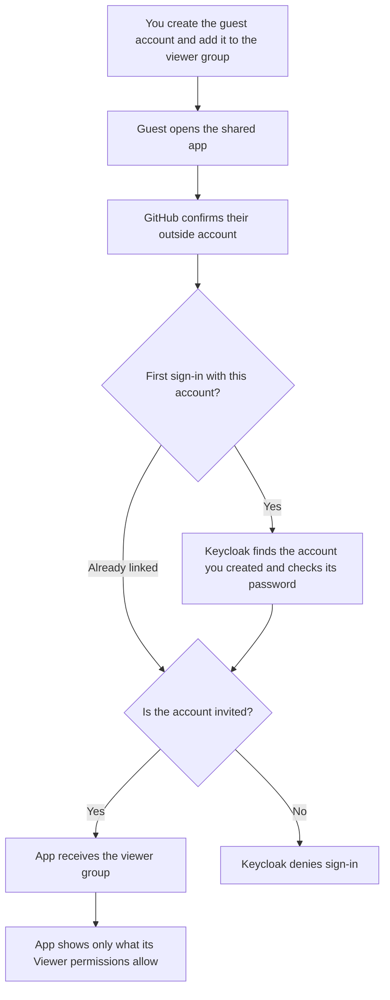

# Invite guests to one app

Pick a server-side app that supports OpenID Connect and can limit permissions
using groups. Terraform creates a separate Keycloak realm named
`guests-<app>` with a sign-in client for that app. The guest's account lives
in that realm, separate from your private `homelab` accounts. Grafana is an
example below. The Terraform files take the app name and return URL as inputs.



Keycloak checks the invitation during the first and later GitHub sign-ins
and when the app reuses a Keycloak session. The app controls the actual data
and actions available to its Viewer.

## 1. Choose the app and register the GitHub sign-in

1. Pick a short app ID, such as `status-board`, and find the exact sign-in
   callback URL in that app's documentation. An example is
   `https://status-board.lab/login/oauth`. The app needs to support the
   authorization code flow with PKCE (`S256`). The guest's browser needs
   access to the app and Keycloak, including DNS and certificate trust. For
   an app that supports just one OpenID Connect configuration and already
   serves private users, use a separate guest-facing instance.
2. Create a **GitHub OAuth App** under **Settings → Developer settings → OAuth
   Apps**. Use the shared app as its homepage URL. With `status-board` and
   `https://auth.lab`, the GitHub **Authorization callback URL** is
   `https://auth.lab/realms/guests-status-board/broker/github/endpoint`.
   GitHub returns to this Keycloak URL. The callback from step 1 is the
   separate URL Keycloak uses to return to the app.
3. Keep the GitHub client ID and generate its secret. This configuration
   uses GitHub because Google requires a recognized public suffix in its
   return URL and `auth.lab` uses a private suffix.

[GitHub OAuth app setup](https://docs.github.com/en/apps/oauth-apps/building-oauth-apps/creating-an-oauth-app) · [Google return URL rules](https://developers.google.com/identity/protocols/oauth2/web-server#uri-validation)

## 2. Create the guest realm

1. Follow [Connect Terraform to Keycloak](../../README.md#connect-terraform-to-keycloak).
   Create `keycloak-terraform` in **master** and assign the `create-realm`
   realm role. It allows Terraform to create the guest realm and manage the
   realms it creates.
2. From the repository root, set the values below. Use one Terraform
   workspace per app so each invitation setup has its own record of what it
   created. Keep the same app ID and workspace on later runs.

   ```bash
   cd terraform/keycloak/guest-access
   export TF_VAR_app_client_id=status-board                          # Names the guest realm and app client.
   export TF_VAR_app_callback_url=https://status-board.lab/login/oauth # App's exact sign-in callback.
   export TF_VAR_github_client_id=YOUR_GITHUB_CLIENT_ID              # From GitHub's OAuth App.
   read -rsp 'GitHub OAuth App secret ' TF_VAR_github_client_secret  # Enter the secret without echoing it.
   export TF_VAR_github_client_secret
   printf '\n'
   terraform init                                                   # Install the Keycloak provider.
   terraform workspace select -or-create "guests-$TF_VAR_app_client_id" # Use this app's state.
   terraform plan -out=guest.tfplan                                  # Review the new realm and its settings.
   ```

   For a different Keycloak hostname, set `TF_VAR_keycloak_url` to its HTTPS
   base URL before planning and use the same hostname in the GitHub callback.
   The plan and state can contain client secrets. Keep both private.
3. Review that the plan targets a new `guests-<app>` realm. Apply and read
   the app settings.

   ```bash
   terraform apply guest.tfplan    # Create the reviewed guest settings.
   terraform output issuer_url     # Address the app uses to discover sign-in endpoints.
   terraform output app_client_id  # Name the app sends to Keycloak.
   terraform output viewer_group   # Group name to map to read-only access.
   ```

## 3. Configure access in the app

1. Enter the issuer URL and client ID in the app. In the guest realm, copy
   the app's Keycloak client secret from **Clients → the app → Credentials**
   into the app's secret settings. Ask for `openid profile email` and turn
   on PKCE. If the app asks for individual endpoint URLs, read the issuer's
   `/.well-known/openid-configuration` page.
2. Require the output viewer group from the `groups` field and map it to the
   app's narrow read-only permissions. Set the app to deny users without
   the required group. The group name is a label Keycloak sends. The app
   decides what it actually grants.

### Grafana example

In the guest-facing Grafana, create a `Guest-Dashboards` organization. Add
these settings to its Generic OAuth configuration, using the viewer group
from `terraform output viewer_group` in both places.

```ini
[auth.generic_oauth]
groups_attribute_path = groups
allowed_groups = grp-status-board-guest-viewers
org_attribute_path = groups
org_mapping = grp-status-board-guest-viewers:Guest-Dashboards:Viewer
role_attribute_path =
role_attribute_strict = true
skip_org_role_sync = false
```

`allowed_groups` controls who can enter. `org_mapping` gives those users
Viewer access in `Guest-Dashboards`. The empty `role_attribute_path` leaves
the organization mapping in charge of the assignment.

Add only the dashboard you chose and a data source restricted to the data
you intend to share. A Grafana Viewer can query **any** data available to a
data source in their organization. Check the guest account's organization
list and data sources before sharing the dashboard link.

[Grafana organization mapping](https://grafana.com/docs/grafana/latest/setup-grafana/configure-access/configure-authentication/generic-oauth/#org-roles-mapping-example) · [What a Grafana Viewer can query](https://grafana.com/docs/grafana/latest/setup-grafana/configure-security/#limit-viewer-query-permissions)

## 4. Invite and verify

1. In `guests-<app>`, create the guest user with the **primary email from
   their GitHub account**, set a unique initial password, and add them to
   `grp-<app>-guest-viewers`. Give them the app URL and share the password
   separately. Users and passwords are created here through the admin console.
2. The first time, the guest signs into GitHub and Keycloak asks for the
   password of the account you created. On later sign-ins, GitHub identifies
   the linked account and Keycloak checks the invitation again.
3. Test with the invited user, an outside GitHub user you did not invite,
   and a pre-created account without the viewer group. Only the invited user
   should reach the app. Check what the guest can read and whether the app
   refuses an edit. Repeat the linked-user test after removing the group.
4. To revoke an invitation, remove the group and sign out that user's Keycloak
   sessions. End their existing app sessions as well, if the app keeps its
   own login session.

[Keycloak first sign-in and account linking](https://www.keycloak.org/docs/26.7.0/server_admin/#_identity_broker_first_login)
