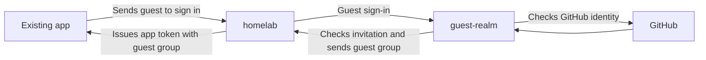

# Invite guests to existing apps

Create one Keycloak realm called `guest-realm` for guests. Every app keeps its
existing `homelab` login. Approve a guest once in `guest-realm` and configure
each app you want to share to allow `grp-guest-viewer`.



| Where | What lives there |
| --- | --- |
| GitHub | One OAuth app for the shared guest realm. |
| `guest-realm` | Guest invitations, GitHub sign-in, `grp-guest-viewer`, and one client called `homelab-guest-broker`. |
| `homelab` | The **Guest sign-in** option, linked guest records, and a matching `grp-guest-viewer` group. |
| Each shared app | The rule that lets the guest group enter and decides what it can read. |

Terraform creates the Keycloak setup above. It starts with **Guest sign-in**
disabled in `homelab` so you can finish the app access rules first. The app
clients and their secrets are already in `homelab`. Terraform connects the
realms using the generated secret from `homelab-guest-broker`.

## 1. Register GitHub once

In GitHub, open **Settings → Developer settings → OAuth Apps → New OAuth App**.

- **Application name** can be `Homelab Guests`.
- **Homepage URL** can be `https://auth.lab`.
- **Authorization callback URL** is
  `https://auth.lab/realms/guest-realm/broker/github/endpoint`.

Generate a secret and keep the GitHub client ID and secret for step 2.
If you use a different Keycloak hostname, use it here and set
`TF_VAR_keycloak_url` before planning. Guests need to be able to open the
Keycloak and app URLs in their browser.
[GitHub OAuth app setup](https://docs.github.com/en/apps/oauth-apps/building-oauth-apps/creating-an-oauth-app)

Keycloak calls `https://auth.lab` to exchange tokens between the realms. If
the Keycloak server does not already trust its Caddy certificate, configure
Keycloak's trust store with the [rpivn Caddy CA](../../../pki/public/rpivn-caddy.crt).
[Keycloak certificate trust](https://www.keycloak.org/server/keycloak-truststore)

## 2. Create the Keycloak setup

Follow [Connect Terraform to Keycloak](../../README.md#connect-terraform-to-keycloak).
Use the `keycloak-terraform` client in **master**. Under its **Service accounts
roles**, assign the realm role **create-realm** and these client roles from
**homelab-realm**.

| Role | What Terraform uses it for |
| --- | --- |
| `view-realm` | Read the existing `homelab` realm. |
| `manage-realm` | Build the first guest sign-in steps in `homelab`. |
| `manage-users` | Create the `homelab` guest group. |
| `manage-identity-providers` | Add the shared sign-in option and group mapping. |

Run from the repository root. Use **one** `shared-guests` workspace for all apps.
If you previously applied a `guests-<app>` workspace, keep its state with its
original configuration.

```bash
cd terraform/keycloak/guest-access
export KEYCLOAK_VERSION=26.7.0                                   # Match your server if Terraform cannot read its version.
export TF_VAR_github_client_id=YOUR_GITHUB_CLIENT_ID              # From the GitHub OAuth app.
read -rsp 'GitHub OAuth app secret ' TF_VAR_github_client_secret  # Read it without echoing it.
export TF_VAR_github_client_secret
printf '\n'
terraform init                                                   # Install the pinned Keycloak provider.
terraform workspace select -or-create shared-guests               # Keep one state for the shared setup.
terraform plan -out=guest.tfplan                                  # Review the new realm and disabled sign-in option.
terraform apply guest.tfplan                                      # Create the reviewed Keycloak resources.
terraform output viewer_group                                     # Name the shared apps should look for.
```

Keep the state and saved plans private. They can contain OAuth secrets.
[Keycloak admin permissions](https://www.keycloak.org/docs/26.7.0/server_admin/#_admin_permissions)

## 3. Decide what guests can open

1. In each shared app, keep its current `homelab` connection. Add
   `grp-guest-viewer` to its access rules and give it the intended read-only
   permissions. If the app reads `groups` from the token, confirm its existing
   Keycloak client sends that field.
2. Check the other apps that use `homelab`. A linked guest is a signed-in
   `homelab` user. Apps that admit every signed-in user need an explicit access
   rule before you enable guest sign-in.
3. For Grafana, use an organization such as **Guest Dashboards** inside
   `grafana.lab`. Map the group to Viewer in that organization only. Add the
   shared dashboards and use data source credentials limited to the data
   guests can see. Check the guest has no membership in the private organization.
   [Grafana organization mapping](https://grafana.com/docs/grafana/latest/setup-grafana/configure-access/configure-authentication/generic-oauth/#org-roles-mapping-example) · [Viewer query access](https://grafana.com/docs/grafana/latest/setup-grafana/configure-security/#limit-viewer-query-permissions)

## 4. Invite a guest and enable sign-in

1. In **guest-realm → Users**, create the guest with their primary GitHub
   email and name. Choose a guest username such as `guest-jamie` and add them to
   `grp-guest-viewer`. Set a unique initial password with **Temporary** off,
   then share it separately from the app link. The first visit uses it to
   confirm the GitHub account link. Later visits use the linked GitHub login.
   An email or username already used in `homelab` is rejected when the guest
   first links, to protect existing accounts.
2. After the app access rules are ready, enable the option.

   ```bash
   export TF_VAR_enable_guest_sign_in=true # Keep this value for later runs while guests are enabled.
   terraform plan -out=guest-enable.tfplan  # Review the Guest sign-in switch.
   terraform apply guest-enable.tfplan    # Show Guest sign-in in homelab.
   ```
3. In a private browser window, open a shared app, choose **Guest sign-in**, and
   finish the GitHub sign-in and first-time password check. Test that an
   invited guest can read only what you intended. Also test a linked guest at
   an unshared app and an uninvited GitHub account at the shared app.

To revoke a guest, remove their group in `guest-realm`, disable their linked
user in `homelab`, and end their active sessions in both realms and the apps.
Keycloak syncs the copied group on a fresh sign-in through the guest realm.
[Keycloak account linking and mapping](https://www.keycloak.org/docs/26.7.0/server_admin/#_identity_broker)
