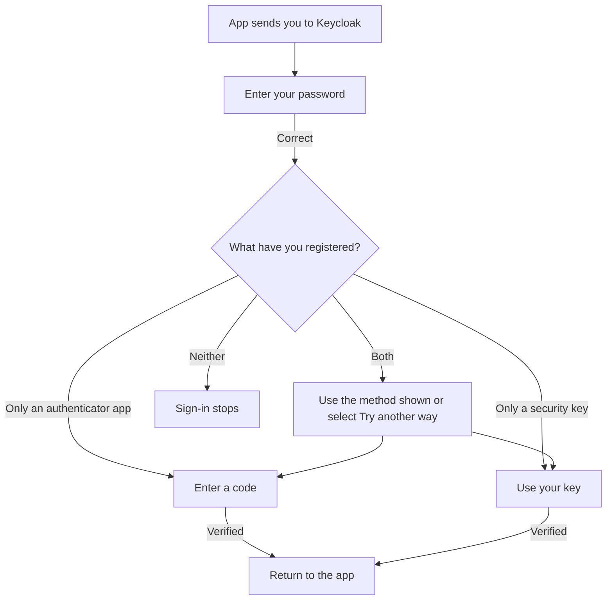

# Password and a second factor

Terraform creates **Password and Second Factor Browser** in `homelab`.
When an app sends a user to this flow, Keycloak asks for their password first.
It then accepts either a code from their authenticator app (OTP) or their
registered security key or passkey (WebAuthn). You choose which apps use the
flow in Keycloak.



## 1. Create the flow

Follow [Connect Terraform to Keycloak](../../README.md#connect-terraform-to-keycloak).
Use the `keycloak-terraform` client in **homelab** with the `manage-realm`
role from `realm-management`. From the repository root, run the following.

```bash
cd terraform/keycloak/mfa-browser
export KEYCLOAK_VERSION=26.7.0 # Match your server if Terraform cannot read its version.
terraform init                # Load the pinned Keycloak provider.
terraform plan -out=mfa.tfplan # Review the flow, required password, and two choices.
terraform apply mfa.tfplan     # Create the flow. You choose which app uses it in step 2.
```

## 2. Enroll a user and connect one app

1. Under **Authentication → Required actions**, enable **Configure OTP** and
   **WebAuthn Register** as needed. Let the test user register their preferred
   method before switching the app. To prompt for setup at the user's next
   sign-in, assign the action in **Users → your user → Details → Required user
   actions**. To test the choice, register both methods for the same user.
2. Pick an app where either method is acceptable. In **Clients → your app →
   Advanced → Authentication flow overrides**, record the current **Browser**
   selection and select **Password and Second Factor Browser**. Check any
   app-specific access rules before replacing a custom flow.
3. Before saving, if the app used the old security-key step-up, record and
   clear its `infra-security-key` **Minimum ACR Value** and any matching
   **Default ACR Values**. Those settings ask for the old security-key level.
   Each new sign-in through the combined flow requires a password and one
   second factor.
4. In a fresh browser, sign in with the password. Test each method in a separate
   sign-in. With both methods enrolled, **Try another way** shows
   **Authenticator Application** and **Passkey**. With neither method enrolled,
   the correct password alone must fail.

To roll back, restore the app's previous **Browser** and ACR settings. If the
older Terraform flow was already applied, keep its state with its original
configuration until you have moved the apps off it.

**Cross-platform** and **Not specified** remain enrollment options under
**Authentication → Policies → WebAuthn Policy → Authenticator Attachment**.
Both work with the same flow. [Keycloak guide to second-factor choices](https://www.keycloak.org/docs/26.7.0/server_admin/#_webauthn)
