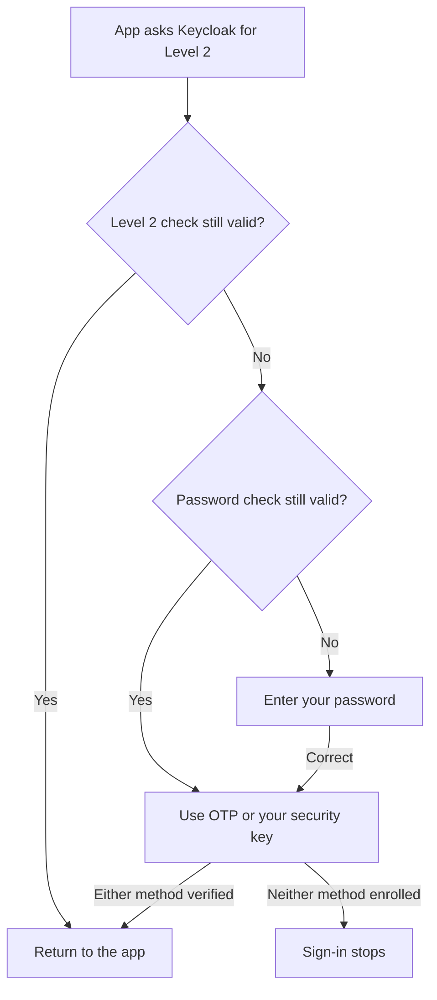

# Password and a second factor

Terraform creates **Password and Second Factor Browser** in `homelab`.
When an app asks for Level 2, the Cookie step looks for an existing Keycloak
session in the same browser. Keycloak can reuse a password check for up to
**10 hours** and a Level 2 check for **five minutes** while that session is
valid. At Level 2, a code from an authenticator app (OTP) or a registered
security key or passkey (WebAuthn) is enough.



## 1. Create the flow

Follow [Connect Terraform to Keycloak](../../README.md#connect-terraform-to-keycloak).
Use the `keycloak-terraform` client in **homelab** with the `manage-realm`
role from `realm-management`. From the repository root, run the following.

```bash
cd terraform/keycloak/mfa-browser
export KEYCLOAK_VERSION=26.7.0 # Match your server if Terraform cannot read its version.
terraform init                # Load the pinned Keycloak provider.
terraform plan -out=mfa.tfplan # Review the Cookie step, both timers, and the two choices.
terraform apply mfa.tfplan     # Create the flow. You choose which app uses it in step 2.
```

## 2. Enroll a user and connect one app

1. Under **Authentication → Required actions**, enable **Configure OTP** and
   **WebAuthn Register** as needed. Let the test user register their preferred
   method before switching the app. To prompt for setup at the user's next
   sign-in, assign the action in **Users → your user → Details → Required user
   actions**. To test the choice, register both methods for the same user.
2. Pick an app where either method is acceptable. In **Clients → your app →
   Advanced → Authentication flow overrides**, record the current **Browser**
   selection and select **Password and Second Factor Browser**. Check any
   app-specific access rules before replacing a custom flow.
3. Keep the existing **ACR to LoA Mapping** of `infra-security-key` to `2` and
   set **Minimum ACR Value** to `infra-security-key`. The label asks Keycloak
   for Level 2. On this flow, either method earns it. Keycloak remembers Level 2
   by its number across the same browser session. Another app using Level 2 in
   the same realm can reuse the OTP check, even if its own flow normally asks
   for a security key.
4. Start in a fresh browser and try each method in a separate sign-in. With
   both enrolled, **Try another way** shows **Authenticator Application** and
   **Passkey**. A user with neither enrolled is denied. On a second app using
   Level 2, start a new sign-in within five minutes in the same browser and
   expect it to complete without a prompt. After five minutes, start a new
   sign-in and expect the second factor again if the password is still valid.

To roll back, restore the app's previous **Browser** and ACR settings. If the
older Terraform flow was already applied, keep its state with its original
configuration until you have moved the apps off it.

**Cross-platform** and **Not specified** remain enrollment options under
**Authentication → Policies → WebAuthn Policy → Authenticator Attachment**.
Both work with the same flow. [Keycloak step-up authentication](https://www.keycloak.org/docs/26.7.0/server_admin/#creating-a-browser-login-flow-with-step-up-mechanism) · [Keycloak second-factor choices](https://www.keycloak.org/docs/26.7.0/server_admin/#_webauthn)
