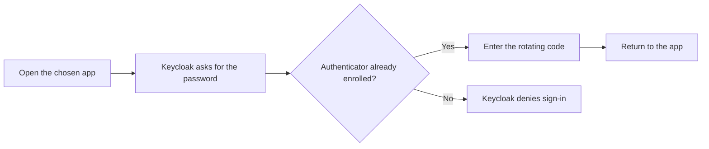

# Require an authenticator code for an app

Terraform creates `Authenticator Code Browser` in `homelab`. The numbers in
the file set the order of the checks within each branch.



The app still decides what the person can do. This flow asks for a code on
each new Keycloak sign-in. It does not award the level used for the shared
passkey check on Longhorn, Arcane, and Proxmox.

## Create the flow

1. Follow [Connect Terraform to Keycloak](../../README.md#connect-terraform-to-keycloak).
   Create `keycloak-terraform` in **homelab** and assign `manage-realm` from
   `realm-management`.
2. From the repository root, run the following.

   ```bash
   cd terraform/keycloak/otp-browser
   export KEYCLOAK_VERSION=26.7.0    # Match your server version if Terraform cannot read it.
   terraform init                    # Install the Keycloak provider.
   terraform plan -out=otp.tfplan    # Preview what will be created.
   ```

   The first plan should show **9 to add, 0 to change, 0 to destroy**.

3. Run `terraform apply otp.tfplan` to create exactly what you reviewed. Check
   **Authentication → Flows → Authenticator Code Browser** in Keycloak.

## Turn it on for an app

1. Start with a test user. On their Keycloak account page, use **Account
   security → Signing in → Authenticator application** to enroll their code
   generator. The ordinary realm sign-in can also ask this user for the code
   once enrolled.
2. In **Clients → your app → Advanced → Authentication flow overrides**,
   record the current **Browser** value and select `Authenticator Code
   Browser`. Pick a client with an empty **Minimum ACR Value** for this flow.
3. Start a fresh app sign-in and check that the password and code work. Try a
   second user without an enrolled code and expect a denial. Restore the old
   **Browser** value to switch the app back.

[Keycloak authenticator setup](https://www.keycloak.org/docs/26.7.0/server_admin/#_credentials)
