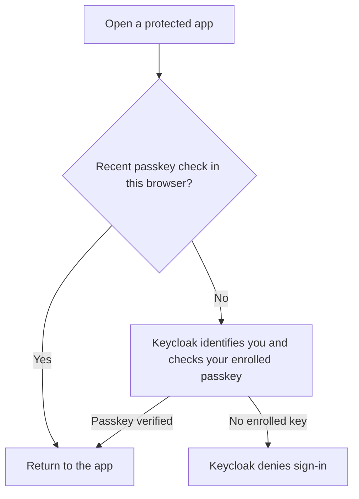

# Require a passkey for an infrastructure app

Terraform creates `Critical Infrastructure Browser (Terraform)` in `homelab`
and puts the login steps in order. Choose which apps use the flow in Keycloak
after it is created.



## 1. Create the flow

1. Follow [Connect Terraform to Keycloak](../../README.md#connect-terraform-to-keycloak).
   Use the `keycloak-terraform` client in **homelab** with `manage-realm`
   from `realm-management`.
2. From the repository root, run these commands.

   ```bash
   cd terraform/keycloak/passkey-browser
   export KEYCLOAK_VERSION=26.7.0    # Match your server if Terraform cannot read its version.
   terraform init                  # Load the pinned Keycloak provider.
   terraform plan -out=passkey.tfplan # Preview the flow and its ordered steps.
   terraform apply passkey.tfplan   # Create the flow in Keycloak.
   ```

## 2. Select the flow on each app

1. Enroll a key for the test user with **Users → your user → Details → Required
   user actions → WebAuthn Register**, then sign in to the Keycloak account
   page. For Windows Hello, choose **Windows device / Windows Hello**.
2. On `longhorn`, `proxmox-ve`, or `arcane-tantrum`, record the current
   **Browser** override. Under **Advanced**, use `infra-security-key` → `2`
   in **ACR to LoA Mapping** and set **Minimum ACR Value** to
   `infra-security-key`. Select `Critical Infrastructure Browser (Terraform)`
   as the **Browser** override. Check any separate access rules before
   switching a client that uses a custom flow.
3. Test one app first. In a fresh browser profile, sign in and use the key.
   Enable the new flow on a second app, then start a new sign-in to that app
   within five minutes in the same browser profile. Expect it to reuse the
   key check. Try after five minutes with a new app sign-in and expect the
   key prompt. Check that a test user with no key is denied.

Restore the previous **Browser** override to revert an app.

## Passkey device choice

The same flow works with either setting. To change which devices can register
new passkeys across `homelab`, go to **Authentication → Policies → WebAuthn
Policy → Authenticator Attachment** in Keycloak.

| Setting | What you can register |
| --- | --- |
| **Cross-platform** | A separate device such as a USB security key or supported phone. |
| **Not specified** | A separate device or a passkey on the current device, such as Windows Hello. |

[Keycloak device enrollment policy](https://www.keycloak.org/docs/26.7.0/server_admin/#_webauthn) · [Keycloak step-up authentication](https://github.com/keycloak/keycloak/blob/main/docs/documentation/server_admin/topics/authentication/flows.adoc#creating-a-browser-login-flow-with-step-up-mechanism)
