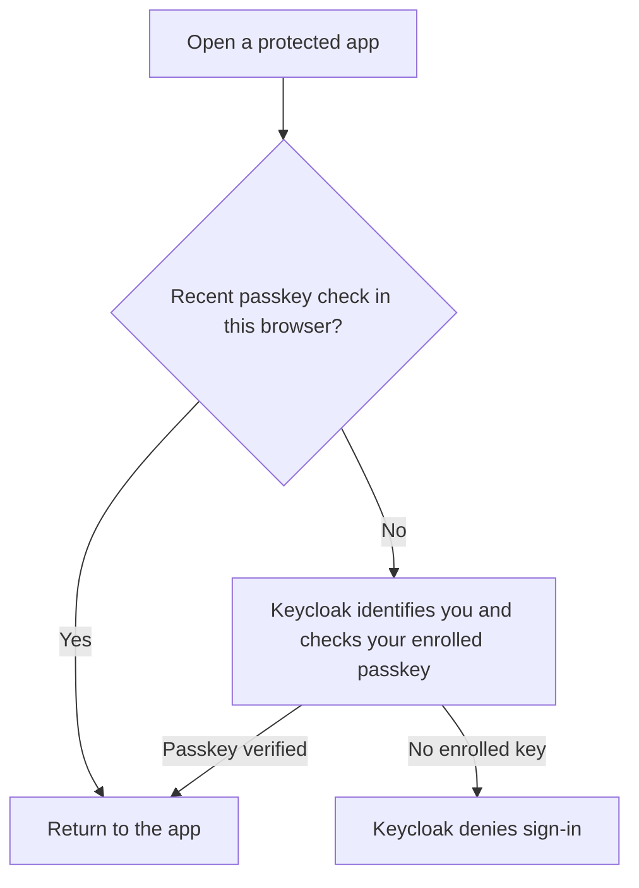

# Require a passkey for an infrastructure app

Terraform creates `Critical Infrastructure Browser (Terraform)` in `homelab`.
Pick one file under `profiles/` to set which devices can **enroll a new key**.
Both profiles use the same sign-in flow and five-minute reuse window.

| Profile | What you can enroll |
| --- | --- |
| `cross-platform.tfvars` | A roaming authenticator such as a physical key or a supported phone. |
| `not-specified.tfvars` | A roaming authenticator or one on the current device, such as Windows Hello. |

Keycloak applies this choice to new registrations across `homelab`. An
already enrolled credential stays registered when you switch profiles.



## 1. Choose the device setting and create the flow

1. Follow [Connect Terraform to Keycloak](../../README.md#connect-terraform-to-keycloak).
   Use the `keycloak-terraform` client in **homelab** with `manage-realm`
   from `realm-management`. Run the commands from a Bash shell with Python 3
   and trust for the `auth.lab` certificate.
2. From the repository root, run these commands. Use `cross-platform.tfvars`
   instead if you prefer a roaming authenticator for new registrations.

   ```bash
   cd terraform/keycloak/passkey-browser
   export KEYCLOAK_VERSION=26.7.0                     # Match your server if Terraform cannot read its version.
   python3 set-attachment.py --show                   # Read the current device setting before choosing.
   terraform init                                    # Load the pinned Keycloak provider.
   terraform plan -var-file=profiles/not-specified.tfvars -out=passkey.tfplan # Preview the flow and device choice.
   terraform apply passkey.tfplan                     # Create the flow and set the chosen enrollment policy.
   ```

   The provider manages the flow. During apply, `set-attachment.py` reads the
   existing WebAuthn policy and realm attributes, sends them back with the
   selected device setting, and verifies the result. This keeps Terraform
   from taking ownership of the entire realm. If someone changes this setting
   in the console later, plan with the same profile and add
   `-replace=terraform_data.enrollment_device` to reapply the choice.

## 2. Select the flow on each app

1. Enroll a key for the test user with **Users → your user → Details → Required
   user actions → WebAuthn Register**, then sign in to the Keycloak account
   page. For Windows Hello, choose **Windows device / Windows Hello**.
2. On `longhorn`, `proxmox-ve`, or `arcane-tantrum`, record the current
   **Browser** override. Under **Advanced**, use `infra-security-key` → `2`
   in **ACR to LoA Mapping** and set **Minimum ACR Value** to
   `infra-security-key`. Select `Critical Infrastructure Browser (Terraform)`
   as the **Browser** override. Check any separate access rules before
   switching a client that uses a custom flow.
3. Test one app first. In a fresh browser profile, sign in and use the key.
   Enable the new flow on a second app, then start a new sign-in to that app
   within five minutes in the same browser profile. Expect it to reuse the
   key check. Try after five minutes with a new app sign-in and expect the
   key prompt. Check that a test user with no key is denied.

Restore the previous **Browser** override to revert an app. To switch the
enrollment choice, plan and apply using the other profile in the same
Terraform directory.

[Keycloak device enrollment policy](https://www.keycloak.org/docs/26.7.0/server_admin/#_webauthn) · [Keycloak step-up authentication](https://github.com/keycloak/keycloak/blob/main/docs/documentation/server_admin/topics/authentication/flows.adoc#creating-a-browser-login-flow-with-step-up-mechanism)
